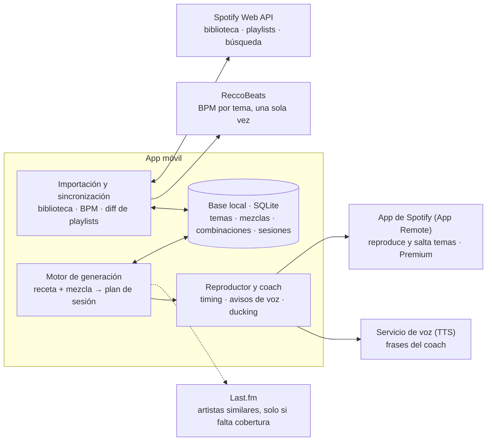

# Arquitectura

La app decide todo en local: recetas, mezclas, selección de temas y guion del coach. Spotify aporta la biblioteca y reproduce; los demás servicios externos dan datos que no tiene Spotify (BPM, artistas similares) o la voz.

## Componentes

| Componente | Responsabilidad |
|---|---|
| Importación y sincronización | OAuth con Spotify; importa temas, artistas y playlists propias; pide BPM a ReccoBeats; en cada renovación lee la playlist de la combinación y calcula el diff con lo que dejó la app. |
| Base local (SQLite) | Fuente de verdad de la app: catálogo de bloques y recetas (cargados de `data/*.json`), temas con BPM, mezclas, combinaciones, historial de sesiones. |
| Motor de generación | Comprueba cobertura, amplía con Last.fm si hace falta, elige temas por bloque y produce el plan de sesión. Escribe la playlist en Spotify. |
| Reproductor y coach | Lanza la reproducción en la app de Spotify, sigue el reloj de la sesión, salta temas recortados y reproduce la voz del coach bajando el volumen de la música. |

## Principios

- **Local primero.** Todo el estado vive en el móvil. No hay backend propio en v1: los tokens de Spotify se guardan en el llavero del dispositivo (OAuth con PKCE, sin secreto de cliente).
- **Cachear lo que no cambia.** El BPM de un tema se calcula una vez y se guarda para siempre. Los datos de artistas y géneros se refrescan como mucho una vez por semana.
- **Aislar a Spotify detrás de un cliente propio.** Spotify ha recortado su API dos veces (noviembre de 2024 y febrero de 2026); un único módulo cliente limita el impacto del siguiente cambio.
- **Servicios externos opcionales donde se pueda.** Last.fm y el TTS de calidad son mejoras: si fallan, la app sigue funcionando (sin ampliación automática; con la voz del sistema).

## Plataforma: iOS nativo (Swift + SwiftUI)

Decidido el 23-10-2026 ([decisión 17](decisiones.md)). Mínimo iOS 17.

| | iOS nativo (elegido) | React Native (descartado) |
|---|---|---|
| SDK de Spotify | Oficial (App Remote) | Sin SDK oficial; envoltorios de la comunidad o módulo nativo propio |
| Audio en segundo plano y *ducking* | Control directo con `AVAudioSession` | Depende de módulos nativos; el hilo JS puede suspenderse con la pantalla bloqueada |
| Precisión de los avisos del coach | Programables en el motor de audio | Sujeta al hilo JS |
| Extras | Live Activities (bloque y cuenta atrás en pantalla de bloqueo y Dynamic Island), Apple Watch + HealthKit | Posibles, con más trabajo nativo |
| Alcance | Solo iPhone | iOS y Android |

El código Swift vivirá en `ios/`.
