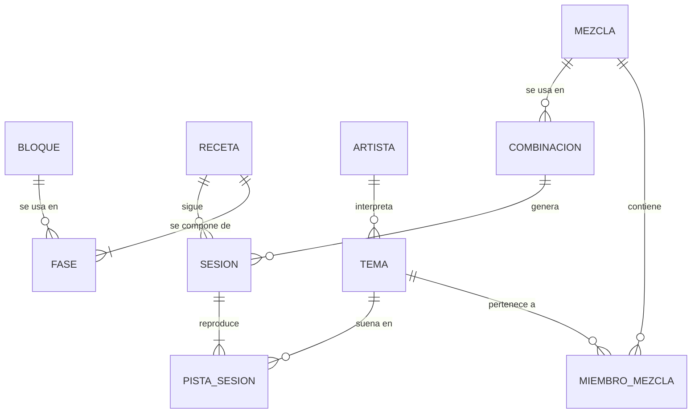

# Modelo de datos

Todo vive en una base SQLite local. Bloques y recetas se cargan de `data/*.json` y no se editan desde la app en v1.

## Entidades

### Bloque y Receta (catálogo)

Definidos en [`bloques.json`](../data/bloques.json) y [`recetas.json`](../data/recetas.json). Ver [Entrenamiento](entrenamiento.md).

| Entidad | Campos |
|---|---|
| Bloque | `id`, `nombre`, `posicion`, `rueda_min/max`, `rpm_min/max`, `relacion_musica`, `factor_bpm` (1 o 2), `bpm_min/max`, `zona`, `frase_coach` |
| Receta | `tipo`, `duracion_min`, `fases[]` |
| Fase | `orden`, `fase` (nombre), `bloque` (id), `minutos`, `nota?` |

### Música

| Entidad | Campos | Notas |
|---|---|---|
| Tema | `spotify_id`, `titulo`, `artista_ids[]`, `duracion_ms`, `bpm`, `bpm_fuente` (`reccobeats`, `manual`…), `bpm_estado` (`pendiente`, `ok`, `sin_dato`), `analizado_en` | El BPM no se recalcula nunca una vez en `ok` |
| Artista | `spotify_id`, `nombre`, `generos[]`, `actualizado_en` | Spotify asigna géneros a artistas, no a temas |
| Mezcla | `id`, `nombre`, `fuentes` (artistas, géneros, playlists propias), `descubrir_pct`, `ampliacion_auto` (bool) | «Latino», «Rock» |
| MiembroMezcla | `mezcla_id`, `tema_id`, `origen`, `estado`, `renovaciones_superadas`, `peso_artista` | Ver estados abajo |

**Origen** de un tema en una mezcla: `biblioteca` (canciones guardadas o playlists propias) · `catalogo_artista` (álbumes de un artista seleccionado) · `anadido_spotify` (lo añadiste a la playlist de la combinación) · `ampliado_lastfm` (artista similar).

**Estado**: `activo` · `prueba` (descubierto, aún no consolidado) · `descartado` (lo quitaste desde Spotify; no vuelve a salir).

Un tema en `prueba` pasa a `activo` tras 3 renovaciones sin que lo quites.

### Combinaciones y sesiones

| Entidad | Campos | Notas |
|---|---|---|
| Combinacion | `id`, `tipo`, `mezcla_id`, `spotify_playlist_id`, `mantener_version` (bool), `ultima_renovacion`, `snapshot_ids[]` | `snapshot_ids` = temas que la app dejó en la playlist la última vez; base del diff |
| Sesion | `id`, `combinacion_id`, `duracion_min`, `semilla`, `fecha`, `completada` | La semilla permite reproducir una generación; «Barajar» = nueva semilla |
| PistaSesion | `sesion_id`, `orden`, `fase_orden`, `tema_id`, `inicio_s`, `fin_reproduccion_s`, `fijada` (bool) | `fin_reproduccion_s` < duración del tema cuando se recorta con fundido |

## Reglas de integridad

- Una combinación es única por (`tipo`, `mezcla_id`).
- Un tema no se repite dentro de una misma sesión.
- Borrar una mezcla exige borrar o reasignar sus combinaciones; las playlists de Spotify no se borran automáticamente.
