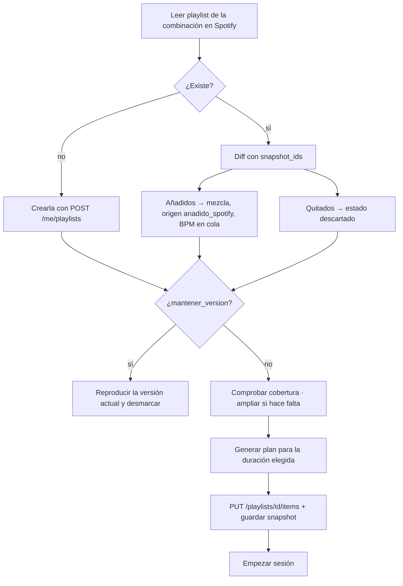

# Motor

El motor convierte una receta y una mezcla en un plan de sesión, mantiene viva la playlist de cada combinación y amplía la música cuando no alcanza.

## 1. Importación y BPM

1. **Importar fuentes**: canciones guardadas, playlists propias y artistas seguidos → tablas `Tema` y `Artista`.
2. **Géneros**: `GET /artists/{id}` uno a uno para cada artista nuevo; refresco como mucho semanal.
3. **BPM**: se consulta a [ReccoBeats](https://reccobeats.com) por ID de Spotify. Resultado en `Tema.bpm` con `bpm_estado = ok`, o `sin_dato` si no hay cobertura.
4. **Caché permanente**: el BPM de un tema no cambia; solo se analizan temas nuevos.
5. **Progresivo**: se puede crear mezclas y sesiones con lo ya analizado mientras el resto termina.

No podemos calcular el BPM nosotros: Spotify no da acceso al audio ni a *previews* para apps nuevas. Si ReccoBeats no cubre lo suficiente, la alternativa es Tunebat (de pago). La cobertura real se mide en la fase 0 ([Plan](plan.md)).

### Mezclas sugeridas (onboarding)

Tras importar, se agrupan los temas por los géneros de sus artistas y se proponen mezclas con nombre y tamaño («Latino · 84 temas»). El usuario las acepta, renombra o descarta. También puede crear una mezcla desde una playlist propia o a mano (artistas + géneros).

## 2. Encaje de un tema en un bloque

Un tema encaja en un bloque si alguno de sus tempos efectivos cae en el rango de BPM del bloque con una tolerancia del 3 %:

```
tempos_efectivos = { bpm, bpm × 2, bpm ÷ 2 }
encaja ⇔ ∃ t ∈ tempos_efectivos : bpm_min × 0,97 ≤ t ≤ bpm_max × 1,03
```

El doble y la mitad cubren los errores típicos de detección y permiten usar, por ejemplo, un tema de 72 BPM en una subida a 144.

## 3. Generación de una sesión

Entrada: receta (fases en orden), temas `activo` y `prueba` de la mezcla, historial de la combinación, temas fijados con candado, semilla.

Para cada fase, en orden:

1. **Candidatos** = temas que encajan en el bloque, no usados ya en esta sesión y no `descartado`.
2. **Peso** de cada candidato:
   - base 1;
   - × 1,5 si el artista o el tema está entre tus más escuchados;
   - × 0,2 si sonó en alguna de las 3 últimas renovaciones de esta combinación;
   - los temas `prueba` y de origen Last.fm se limitan al `descubrir_pct` de la mezcla.
3. **Selección**: muestreo ponderado sin reemplazo (con la semilla) hasta que la suma de duraciones alcance los minutos de la fase. Los temas fijados entran primero.
4. **Ajuste de duración**: si el último tema se pasa, se recorta con fundido en `fin_reproduccion_s`. Si se pasa más de la mitad de su duración, se prueba otro candidato más corto antes de recortar.
5. **Sin candidatos suficientes**: se amplía la tolerancia al 6 % y se marca un aviso en la fase. (Con la regla de cobertura del apartado 5 esto debería ser raro.)

Salida: lista de `PistaSesion` (tema, fase, inicio, fin de reproducción).

«Barajar todo» repite la generación con otra semilla respetando los candados; «Regenerar bloque» lo hace solo para una fase.

## 4. Renovación de una combinación

Ocurre al pulsar «Renovar y empezar».



Detalles:

- **Añadidos que no encajan** en ningún bloque de la receta se quedan en la mezcla; la app muestra «no encaja en este entrenamiento» para que se entienda por qué no suenan.
- **Quitar un tema descubierto** baja también el peso de su artista (× 0,5) para futuras ampliaciones.
- **Reordenar** la playlist en Spotify no tiene efecto: el orden lo decide la receta.
- **Si se lanza la playlist desde Spotify** sin pasar por la app, suena la versión anterior: Spotify no notifica a la app.
- La playlist guardada contiene **temas completos**; los recortes con fundido solo existen cuando la app controla la reproducción.

## 5. Cobertura y ampliación con Last.fm

**Regla**: una combinación está cubierta si, para cada bloque de la receta de **60′** de su tipo, los candidatos que encajan suman al menos **1,5 ×** los minutos que la receta pide de ese bloque (sumando todas sus apariciones, porque un tema no se repite en una sesión). Si cubre 60′, cubre 15, 30 y 45′.

Ejemplo: HIIT 60′ pide 9′ de Recuperación en total → hacen falta ≥ 13,5′ de temas que encajen en Recuperación.

Se comprueba al crear la combinación y en cada renovación (quitar temas desde Spotify puede dejarla corta).

**Si no está cubierta**, para cada bloque deficitario:

1. **Semillas**: los 5 artistas con más temas activos en la mezcla.
2. **Similares**: Last.fm `artist.getSimilar`; se quedan los de similitud ≥ 0,5 que no estén ya en la mezcla y cuyos géneros en Spotify coincidan con los de la mezcla (evita que «Latino» derive).
3. **Temas**: Last.fm `artist.getTopTracks` (10 por artista) → búsqueda en Spotify `track:"…" artist:"…"` para obtener el ID → BPM.
4. **Filtro**: solo entran los que encajan en el bloque deficitario, como `ampliado_lastfm` en estado `prueba`.
5. **Parada**: cuando el bloque queda cubierto o tras 15 temas añadidos en esa ampliación.

Si tras ampliar sigue sin cubrirse, la app avisa del bloque que falla («faltan temas a 110–115 BPM para el sprint») y sugiere añadir artistas.

Last.fm es gratuito con API key para uso personal; un uso comercial exigiría revisar sus condiciones.
